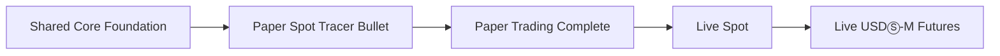

# TiewTrade Project Plan

## วัตถุประสงค์

เอกสารนี้กำหนดลำดับการส่งมอบ dependencies และ quality gates ของ TiewTrade
Internal Alpha โดยใช้ `PRODUCT.md` เป็นขอบเขตผลิตภัณฑ์, `CONTEXT.md` เป็นคำศัพท์และ
กฎโดเมน และ `ARCHITECTURE.md` เป็นเจ้าของ Module กับ dependency rules

หาก implementation plan ราย issue ขัดกับเอกสารทั้งสามชุด ต้องแก้แผนให้ตรงก่อนเริ่ม
production code

## Delivery Principles

- ส่งมอบแบบ Paper-first: พิสูจน์ flow ด้วย Paper Trading ก่อนเปิด Live
- Paper-first ไม่ใช่ Paper-only business logic; Strategy, capital, Basket, Entry Pair,
  risk policy และ PnL ใช้ implementation ร่วมกันทุก Trade Mode
- Paper, Live Spot และ Live Futures ใช้ execution adapters แยกกัน
- ค่าใน form ต้องผ่าน validation และกลายเป็น immutable Session configuration/policy
- `max_entries`, symbol และ timeframe ห้าม hard-code ใน business logic
- 10 Entries เป็นค่าเริ่มต้นของ form เท่านั้น
- หนึ่ง installation ใช้ Binance Account เดียวและมี Active Bot Session ได้สูงสุดหนึ่ง Session
- สร้าง Module หรือ seam เมื่อมีพฤติกรรมและ consumer จริง ไม่สร้างโครงว่างล่วงหน้า
- ระหว่างพัฒนาใช้ Paper และ fake adapters เท่านั้น ห้ามส่ง Live order

## Delivery Order



แต่ละ milestone ต้องผ่าน acceptance และ verification ของตนเองก่อนเริ่ม milestone
ถัดไป การผ่าน technical gate ไม่ได้เปิด Live อัตโนมัติ; Live ต้องผ่าน Preflight และ
การยืนยันจากผู้ใช้เสมอ

## Milestone 1 — Shared Core Foundation

Foundation ที่พร้อมใช้งานแล้วประกอบด้วย:

- shared immutable `SessionConfig` สำหรับ Paper และ Live
- `MarketDataConfig`, immutable Candle และ completed-candle continuity
- `EntryPolicy` ที่รับค่าจาก Session setup
- Spot capital allocation, symbol quantization และ minimum-notional check
- Basket weighted average, Take Profit, realized PnL และ atomic state transitions
- Entry Pair และ Cooldown Policy lifecycle แบบ UTC

Foundation ไม่เลือก execution adapter และไม่มี side effect ไปยัง Binance

## Milestone 2 — Paper Spot Tracer Bullet

Tracer Bullet เป็น headless flow สำหรับพิสูจน์ shared core ผ่าน Paper Spot โดยใช้
BTCUSDT 5m เป็น acceptance scenario ที่ส่งผ่าน configuration ไม่ใช่ค่าคงที่ใน
business logic

ลำดับงานที่เหลือ:

1. DEV-78 — สร้าง RSI Step Grid Preset, Wilder RSI/ATR และ deterministic Entry Intent
2. DEV-79 — เชื่อม Strategy, Capital, Basket และ lifecycle ใน application
   orchestration กับ concrete Paper Spot execution adapter
3. DEV-80 — Replay CSV 40 Candles, สร้าง stable JSON summary และพิสูจน์ว่า
   replay ข้อมูลเดิมสองครั้งได้ output ตรงกันทุกตัวอักษร

Implementation details อยู่ใน
`docs/superpowers/plans/2026-07-20-paper-spot-core-tracer-bullet.md`

Tracer Bullet ยังไม่ถือว่า Paper Trading Complete เพราะยังไม่มี persistence,
Recovery, Paper Futures, public market-data runtime และ Desktop UI

## Milestone 3 — Paper Trading Complete

ส่งมอบ vertical slices ต่อจาก tracer ตามลำดับ dependency:

1. บังคับ one Active Bot Session สำหรับ installation และ Session ownership โดยตรง
2. เพิ่ม SQLite migrations, durable trade history, audit trail และ Recovery state
3. Public Binance market-data adapter, reconnect, backfill และ stale-data fail closed
4. Paper Futures Core: shared Futures PnL policy, immutable session policy, leverage, Cross Margin, Collateral Buffer และ Funding Fee `0.00`
5. Paper Futures Execution: concrete executor และ deterministic Paper fills
6. DEV-95 — เชื่อม Paper Futures เข้ากับ Trade History ด้วย normalized
   Basket/Fill schema, immutable leverage context, Funding Fee `0.00` และ
   atomic/idempotent SQLite flow เดียวกับ Spot
7. Desktop Session Setup vertical slice: สร้าง immutable Active Paper Session แบบ
   atomic, แสดง durable Overview และวาง Thin PySide6 worker boundary
8. DEV-96 — เพิ่ม Trade History UI หลัง Desktop Session Setup acceptance gate ผ่าน
9. Desktop UI สำหรับ Dashboard, Orders, Positions และ Notifications
10. Stop Session, startup Recovery และ deterministic reconciliation ด้วย fake adapters
11. Paper acceptance ครบทั้ง business rules, persistence, UI และ Recovery

สถานะ DEV-92–DEV-95: durable SQLite Trade History รองรับ normalized Basket/Fill
ของ Paper Spot และ Paper Futures, exact Decimal/UTC round-trip, deterministic IDs,
atomic writes, idempotent duplicate handling, ownership/lifecycle validation,
fail-closed Session state และ immutable Futures leverage context รวมทั้ง application
query สำหรับ filter, deterministic ordering, pagination, total count และ
closed-Basket Net Realized PnL แล้ว ส่วน Desktop UI และ startup Recovery ยังคงอยู่ใน
ลำดับถัดไปของ milestone นี้

สถานะ DEV-99: public Binance market-data Runtime รองรับ Historical Warm-up,
completed-candle live flow, gap backfill, stale-data fail closed, bounded reconnect
และการเลือก Spot หรือ USDⓈ-M Futures public endpoint จาก Session configuration แล้ว
งานนี้ยังไม่ทำให้ Paper Trading Complete; Paper Futures persistence ถูกส่งมอบใน
DEV-95 แล้ว แต่ Desktop UI, Stop Session และ startup Recovery ยังคงอยู่ในลำดับถัดไป
ของ milestone นี้

สถานะ DEV-115/DEV-116 (กู้คืนผ่าน DEV-130): Desktop Session Setup acceptance
พิสูจน์ Paper Spot และ Paper Futures ตั้งแต่ form, durable create, Overview,
restart/restore, duplicate suppression และ fail-closed paths โดยไม่เริ่ม Market Data,
Strategy หรือ Execution แล้ว Background-task lifecycle ถูกย้ายจาก `MainWindow` ไปอยู่
ใน focused `SessionWorkflow` ซึ่งดูแล startup load, create, busy state, sanitized error
mapping, task cleanup และ late-callback invalidation โดยไม่เปลี่ยน SQLite schema,
application contract, UI copy หรือ business rules

สถานะ DEV-96: Desktop Trade History แสดง Basket History และ Trade Fills ของทุก
Session ผ่าน application query แบบ filter/pagination บน background worker พร้อม
Total Net PnL, UTC date range, accessible PnL state และ scoped unavailable states แล้ว
งานนี้ปลด prerequisite ด้าน UI เพื่อเริ่ม DEV-97 แต่ยังไม่ทำให้ Paper Trading Complete
จนกว่า acceptance, Stop Session และ startup Recovery ที่เหลือจะผ่าน

สถานะ DEV-97: real Paper Spot/Futures execution เข้าสู่ durable SQLite และ Desktop
Trade History แล้ว โดย restart คง Basket, Fills และ exact closed Net PnL เดิมไว้ครบ;
ครอบคลุม Open Basket, duplicate, Partial Fill และ SQLite fail-closed semantics โดยไม่
เพิ่มพฤติกรรม Live, network หรือ credentials งานนี้ปิด Trade History acceptance slice
เท่านั้น และยังไม่ทำให้ Stop Session, startup Recovery หรือเกณฑ์ Paper Trading Complete
ทั้งหมดเสร็จ

สถานะ Unified Trading Workspace slice 1: Desktop UI ใช้ Full Dark Theme และรวม
Session Setup, configured Session summary และ Trade History ไว้ใน Workspace หน้าเดียว
พร้อม responsive Bot Control แล้ว ส่วน dynamic Runtime read model, Start/Stop/Recovery,
Notifications และ Chart ยังคงส่งมอบตาม Sub-issues ถัดไป

สถานะ DEV-133: ส่งมอบ immutable Trading Workspace read model พร้อม exact
Decimal/UTC contracts, background generation-safe refresh และ persistent status header
แล้ว ส่วน Bot lifecycle controls, durable Orders/Basket integration, Runtime
Start/Stop/Recovery, Notifications และ Chart ยังคงอยู่ใน Sub-issues ถัดไป

สถานะ DEV-134: ส่งมอบ Bot Control แบบ state-driven ที่ render immutable Session
Overview และ Workspace snapshot เดียวกับ Header, พร้อม fake lifecycle seam สำหรับ
Start/Stop/Recovery, repeated-action guard และ stale-callback suppression แล้ว
production desktop จะแสดง Configured Start ที่ปิดใช้งานอย่างซื่อสัตย์จนกว่าจะมี
integration จริง; Runtime Start/Stop/Recovery จริงยังคงเป็น DEV-136 โดยไม่มี
network, SQLite Basket/Fill หรือ execution side effect ใน slice นี้

สถานะ DEV-135: ส่งมอบ Open Orders และ Position / Basket tabs ที่แยก state และ render
immutable application facts โดยหนึ่ง Order ที่มีหลาย Partial Fills แสดงหนึ่ง row และ
Paper Spot Basket คง `entry_count` หนึ่งครั้งต่อ Order ส่วน durable Trade History
ยังเปิดดูได้โดยไม่มี Active Bot Session พร้อมรักษา filters, pagination, Fill details และ
last-known rows เมื่อ refresh ล้มเหลว งานนี้ไม่เพิ่ม Runtime source, Open Orders schema,
network หรือ Live execution; authoritative Runtime refresh และ lifecycle ownership
ยังคงเป็นขอบเขต DEV-136

สถานะ DEV-136: ส่งมอบ Paper Spot/Futures Runtime lifecycle จริงตั้งแต่ Start, public
market-data Warm-up และ completed-candle flow ไปจนถึง immutable Workspace snapshot,
durable Basket/Fill, Stop ภายใน deadline 30 วินาที และ controlled Desktop shutdown แล้ว
โดย Stop ปิดการสร้าง Entry ใหม่แต่คง Open Basket และ Basket Take Profit ไว้โดยไม่
force close เมื่อเริ่มโปรแกรมใหม่แล้วพบ lifecycle marker เป็น `RUNNING` ระบบถือว่า
Runtime เดิมไม่ปลอดภัยและใช้ Recovery แบบอนุรักษ์นิยมเพื่อรับรู้เหตุขัดข้องและจบเป็น
`STOPPED` อย่างปลอดภัยเท่านั้น ระบบจะไม่สร้าง indicator state หรือ pending Entry Intent
ย้อนหลังจากข้อมูลที่ไม่เพียงพอ ความล้มเหลวจาก SQLite หรือ public market-data Runtime
จะแสดงเฉพาะสถานะ `BLOCKED` และข้อความที่ผ่านการ sanitize ส่วน Notifications, Chart UI
และ Live Trading ยังเป็นงานในลำดับถัดไป

สถานะ DEV-137: ส่งมอบ Notification Center ใน Desktop UI เป็น in-memory read model
สำหรับ `Blocked`, data `Stale`, recovery และ runtime transition พร้อม unread/highest
severity, UTC drawer rows, acknowledge แบบ idempotent และ deduplicate snapshot ซ้ำ
โดย acceptance แบบ Paper/fake ยืนยันว่า acknowledge ไม่เปลี่ยน SQLite trading state
และไม่มี network attempt ขณะที่ static dependency proof ยืนยันว่า Notification UI ไม่มี
dependency ไปยัง credentials, private endpoint หรือ Live adapter; งานนี้ไม่เพิ่ม
notification persistence, business/risk policy หรือ Live execution

DEV-137 ถูกถอดออกทั้งระบบใน commit "strip the workspace down to chart, tables and bot
control" (12 ส.ค. 2026) เพราะ drawer และระบบแจ้งเตือนที่เปิดมันอ่านเป็น running commentary
ที่แย่งพื้นที่ชาร์ต ตั้งแต่นั้น "Notifications" ในหน้าจอหลักของ PRODUCT.md 13 ไม่มี UI รองรับ
จนถึง slice ด้านล่างที่แทนที่ด้วยแท็บใหม่ ซึ่งเป็นคนละงานคนละรูปแบบ — ไม่มี unread/drawer/acknowledge

สถานะ Session Cooldown Policy slice: Cooldown เปลี่ยนจากค่าคงที่ของ product มาเป็นค่าที่ผู้ใช้
เลือกตอนสร้าง Session — 1–30 วัน หรือ `Off` — โดยค่าเริ่มต้นคือ 30 วันซึ่งบล็อกนานที่สุด
Session ที่ประกอบขึ้นโดยไม่ได้เลือกจึงระมัดระวังที่สุดเสมอ จำนวนวันวัดด้วยเวลาของ candle
ไม่ใช่นาฬิกาของเครื่อง replay ชุด candle เดิมจึงให้คำตอบเดิม ตัว Cooldown เองไม่ถูกเก็บลง
ฐานข้อมูล เพราะอ่านกลับได้จาก Entries ที่ยังเปิดค้างและ `filled_at` ของ Fill ที่ทำให้ Pair ครบ
"Cancel Cooldown" ตัดการรอได้ครั้งละหนึ่ง Cooldown ทั้ง Paper Spot และ Paper Futures โดย Spot
persist waiver ไว้ให้อยู่รอดข้าม restart ส่วน Futures ไม่เก็บเพราะไม่รับ Basket ที่เปิดค้างกลับมา
Desktop แสดง Cooldown ทั้งบนทุกแถวของ Position tab, ปุ่ม Cancel ข้างแท็บ และการ์ดแจ้งเตือน
ข้าง Bot Control ด้วยถ้อยคำชุดเดียวกัน เพื่อไม่ให้ Cooldown เดียวถูกอ่านเป็นคนละเรื่องในสองที่
งานนี้ไม่แตะ Live, network หรือ credentials

สถานะ Chat Notification Channels slice: notice ที่ `application` เป็นเจ้าของ
(`EntryOpenedNotice`, `BasketClosedNotice`, `CooldownStartedNotice`, `CooldownEndedNotice`,
`CooldownCancelledNotice`, `MarketFeedLostNotice`, `MarketFeedRestoredNotice`,
`BotErrorNotice`) ออกไปถึงเครื่องของผู้ใช้จริงได้แล้วผ่าน LINE Messaging API push และ
Telegram Bot API `sendMessage` เปิดพร้อมกันได้ทั้งสองช่อง ช่องที่ปิดหรือกรอกไม่ครบจะไม่ถูก
เปิดเลยและไม่กระทบอีกช่อง credential ทั้งสองอยู่ใน OS keyring เท่านั้น ตั้งค่าได้จากหน้า
Settings ของ Desktop คิว การ retry หนึ่งครั้ง การ log และการเรียบเรียงข้อความอยู่ใน
`integrations/notifications` ที่ไม่ผูกกับช่องทางใด ส่วน socket และการอ่านว่า status ที่ตอบกลับมา
ควร retry หรือไม่อยู่ใน `http_push.py` ที่ทั้งสองช่องใช้ร่วมกัน Session ที่ราย notice ไม่เคยรอ
socket และ push ที่ล้มเหลวถูก log แล้วทิ้ง ไม่ย้อนกลับไปกระทบ trading decision ใด
acceptance พิสูจน์เส้นทางทั้งเส้นแล้ว ตั้งแต่ candle ที่ทำให้ Bot เปิด Entry ไปจนถึง request ที่ถึง
socket ปลอมของทั้งสองช่อง ครอบทั้งกรณีส่งถึง, กรณี 5xx ที่ถูกถามซ้ำอีกครั้งด้วยข้อความเดิม และ
กรณีถูกปฏิเสธซึ่งไม่ retry ไม่ทำให้อีกช่องเงียบ และไม่กระทบ Entry ที่บันทึกไว้แล้ว
งานนี้ยังไม่มี notification persistence

สถานะ Workspace refinements slice: ผู้ใช้ตั้ง Title ของ installation เองได้จากหน้า Settings และ
toolbar สวมชื่อนั้นทั้งชื่อ เพื่อให้คนที่ดูแลหลายเครื่องแยกหน้าต่างตรงหน้าออกจากเครื่องข้าง ๆ ได้
Title เก็บเป็นไฟล์ข้างฐานข้อมูล ไม่ใช่ใน SQLite ที่ "Clear All Database" จะกวาดไปพร้อม
ประวัติ และไม่ใช่ที่เดียวกับ credential ซึ่งมันไม่ใช่ นอกจากนี้ Position History อ่านตามวันที่
Basket ปิดตาม spec ของตัวเอง และ Bot Control panel ยืนได้โดยไม่มี scroll bar

สถานะ Stop / startup Recovery acceptance slice: เรื่องที่ผู้ใช้เจอจริงถูกพิสูจน์ต่อกันทั้งเส้นแล้ว —
เครื่องดับตอนที่ Basket ยังเปิดอยู่ เปิดโปรแกรมอีกครั้ง แล้ว Position เดิมยังอยู่ครบ Recovery เขียน
marker เป็น `STOPPED` โดยไม่ยิงขอ candle ใด ๆ จึงไม่สร้าง indicator state หรือ Entry Intent ย้อนหลัง
และไม่เพิ่ม Basket หรือ Fill ใหม่เลย เมื่อกด Start อีกครั้ง Bot รับ Basket เดิมกลับมาพร้อม Take Profit
ของมัน ส่วน caller ที่ยังไม่ได้อ้างสิทธิ์ installation จะไม่แตะ marker และคง `BLOCKED` ไว้ เพราะ marker
ที่ Bot ที่ยังมีชีวิตถืออยู่ อ่านแล้วเหมือนกับ marker ที่ Bot ที่ตายแล้วทิ้งไว้ทุกประการ

สถานะ Notification persistence slice: notice ที่ Bot พูดถูกเก็บลง SQLite แล้วตาม PRODUCT.md 14 —
`session_notices` คือเหตุการณ์ ผูกกับ `session_id` และ `session_notice_deliveries` คือผลของแต่ละช่องทาง
(ส่งถึง/ถูกปฏิเสธ/ตอบไม่ได้, status ที่บริการตอบกลับ และจำนวนครั้งที่ยิง) `notice_id` คำนวณจากตัวเหตุการณ์
สองช่องทางและการ raise ซ้ำหลัง restart จึงลงเป็นแถวเดียว เขียนก่อน push เสมอ notice จึงถูกเก็บแม้ไม่ได้
ตั้งช่องทางไว้เลย และการเขียนที่ล้มเหลวเสียแค่บันทึก ไม่หยุด Session ตามกฎเดียวกับ push
acceptance พิสูจน์แล้วว่าข้อความที่ผู้ใช้ได้รับกับผลของแต่ละช่องอ่านกลับได้จากไฟล์เดิมหลังเปิดใหม่
หน้าจอที่อ่านบันทึกนี้กลับมาแสดงส่งมอบแล้วเช่นกัน: แท็บ Notifications ข้าง Position/Position
History/Trade History แสดง notice ของ Session ที่กำลังดูอยู่ ใหม่สุดก่อน แต่ละแถวบอกเวลา ข้อความที่
เปิดเรื่อง และผลของทุกช่องทางที่ตั้งค่าไว้ (ส่งถึง/ถูกปฏิเสธพร้อม status/ไม่ตอบ) อ่านผ่านเฉพาะ
`application/session_notices.py` ที่ `ui` ได้รับอนุญาต ไม่แตะ `integrations/sqlite` โดยตรง โหลดแบบ lazy
เมื่อแท็บถูกเปิดเท่านั้น ป้องกัน read ที่ไม่มีใครดู และมี generation guard กัน reply ของ Session เก่า
มาทับของ Session ที่เพิ่งสลับไปดู

## Milestone 4 — Live Spot

เริ่มได้เมื่อ Paper Trading Complete ผ่านทั้งหมด:

- เก็บ credentials ใน OS Keyring เท่านั้น
- เพิ่ม Live Spot adapter ที่ consumer Module ใช้งานจริง
- เพิ่ม execution interface ที่ consumer เป็นเจ้าของเมื่อมี Paper และ Live adapters
  อย่างน้อยสองแบบ
- บังคับ Preflight, explicit confirmation, idempotency, Reconciliation และ safe shutdown
- ทดสอบด้วย fake transport และ contract tests ก่อนเชื่อมบัญชีจริง

การทดสอบเงินจริงต้องได้รับคำสั่งจากผู้ใช้แยกต่างหาก

## Milestone 5 — Live USDⓈ-M Futures

เริ่มได้เมื่อ Live Spot gate ผ่าน:

- ใช้ Futures adapter แยกจาก Spot
- บังคับ Cross Margin, leverage cap, Futures capital policy และ Collateral Buffer
- รองรับ funding account facts
- ผ่าน Preflight, idempotency, Reconciliation และ Recovery สำหรับ Futures semantics

## Module Ownership

| Concern | Owner Module | หมายเหตุ |
| --- | --- | --- |
| Candle และ continuity | `market_data` | รับ symbol/timeframe จาก configuration |
| Session และ immutable policies | `trading` | ไม่เลือก adapter |
| RSI Step Grid | `strategies/rsi_step_grid` | ไม่รู้จัก Paper หรือ Live |
| Basket, capital, Entry Pair, Futures PnL และ margin policy | `trading` | ใช้ร่วมกันทุก Trade Mode; policy เป็น side-aware |
| Session และ completed-candle orchestration | `application` | จัดลำดับ shared business rules กับ execution adapter |
| Paper execution | `execution` | จำลอง deterministic Paper fills และ side effects โดยไม่เรียก Binance |
| Binance public market data | `integrations/binance` | ส่งมอบใน Paper Trading Complete โดยไม่ใช้ credentials |
| Binance Live execution | `integrations/binance` | เพิ่มตาม Live gates เท่านั้น |
| Persistence | `integrations/sqlite` | จัดการ transaction, durable mapping และ persistence-specific fail-closed coordinator; ไม่เก็บ secrets |
| Notice, คิว, retry และการเรียบเรียงข้อความ | `integrations/notifications` | ไม่ผูกกับช่องทางใด รับชื่อช่องทางมาเป็นค่า; socket ร่วมอยู่ใน `http_push.py` |
| Chat transport | `integrations/line`, `integrations/telegram` | ถือเฉพาะ address, payload และตำแหน่งที่ token เดินทาง |
| Credentials | `integrations/keyring` | OS keyring เท่านั้น ไม่ลง SQLite, config, fixture หรือ log |
| ค่าตั้งของเครื่องที่ไม่ใช่ความลับ | `integrations/preferences` | เช่น Bot Title; อยู่ข้างฐานข้อมูล ไม่ปนกับ credential หรือประวัติการเทรด |
| Desktop UI | `ui` | ไม่ถือ business rules |

`execution` เป็นเจ้าของ deterministic simulation ภายในโปรแกรม ส่วน side effects ที่
ออกไปยังระบบภายนอกเป็นของ `integrations/<provider>` เสมอ

## Quality Gates

ทุก Issue ต้องรัน checks ที่เกี่ยวข้องกับขอบเขตงาน และ integration gate ของแต่ละ
milestone ต้องรัน checks ทั้งหมดต่อไปนี้:

```bash
.venv/bin/python -m pytest -q
.venv/bin/python -m ruff check src tests
.venv/bin/python -m ruff format --check src tests
.venv/bin/python -m mypy
npm --prefix docs-site test
npm --prefix docs-site run check:content
git diff --check
```

Issue ที่กระทบ application flow ต้องเพิ่ม deterministic acceptance test Issue ที่กระทบ
docs-site ต้องผ่าน production build และ Issue ที่แตะ execution/recovery ต้องใช้ fake
adapter หรือ fake transport ระหว่าง verification

## Change Control

- เปลี่ยน business rule หรือ safety gate ต้องแก้ `PRODUCT.md` ก่อน
- เปลี่ยนคำศัพท์หรือ ownership ต้องแก้ `CONTEXT.md` หรือ `ARCHITECTURE.md`
- เปลี่ยน Strategy behavior ที่มีผลต่อ Session ต้องสร้าง Preset version ใหม่
- เปลี่ยนลำดับการส่งมอบหรือ dependency ต้องแก้เอกสารนี้และ implementation plan ที่เกี่ยวข้อง
- ห้ามเปลี่ยนผลของ Session เดิมโดยเงียบ ๆ
