# Basket Lifecycle

Basket รวม Entries ของรอบการสะสม Position เดียวกันและมี Take Profit ร่วมกัน Basket หนึ่งมีได้สูงสุดตาม `max_entries` ของ immutable Session policy ทุกการคำนวณอ้างอิง Fill ที่ยืนยันแล้ว ไม่ใช้เพียง Order หรือ Entry Intent

## Weighted Average

หลัง Entry Fill แต่ละครั้ง ระบบคำนวณราคาเฉลี่ยถ่วงน้ำหนักจากราคาและ quantity จริง:

```text
weighted_average_entry_price =
  sum(fill_price × filled_quantity) / sum(filled_quantity)
```

Quantity รวมของ Basket คือผลรวม filled quantity ที่ Bot เป็นเจ้าของ ราคาและ quantity ต้องสอดคล้องกับ tick size, step size และ minimum notional ของ BTCUSDT โดยใช้ Decimal เพื่อหลีกเลี่ยงความคลาดเคลื่อนแบบ floating point

## Take Profit

```text
take_profit_price = weighted_average_entry_price + (ATR(14) × 3)
```

Take Profit ทำงานสองระดับ: **Entry Pair** เป็นระดับปกติที่ Position ออก วัดจากราคาเฉลี่ยของ Entries ใน Pair นั้น และ **Basket** เป็นตาข่ายวัดจากราคาเฉลี่ยของทั้งใบ ซึ่งกวาดทุก Entry ที่เหลือออกพร้อมกัน ATR คือค่าล่าสุดจาก completed Candle ณ เวลาที่ Entry Fill โดยยึด ATR ของ Entry ที่ยังเปิดอยู่และ Fill ล่าสุด ทุก Fill **และการปิด Entry รายตัว** ทำให้ระบบคำนวณ weighted average และ Take Profit ทั้งสองระดับใหม่ เพราะทั้งสองเหตุการณ์เปลี่ยนราคาเฉลี่ย แล้วปัด target ตาม tick size ของ BTCUSDT จากนั้น place หรือ replace Take Profit Order สำหรับ quantity ทั้งหมดที่ Bot เป็นเจ้าของใน Basket สำหรับ Live Order นี้อยู่บน exchange และยัง active หลัง Stop Session

Paper execution ไม่คิดต้นทุนการเทรด realized PnL จึงเป็นส่วนต่างราคาล้วน ๆ; Live ในอนาคตต้องใช้ fee และ funding ที่เกิดขึ้นจริงจาก Binance

## State Transitions

State diagram นี้แสดงช่วงที่ Basket ว่าง, มี Take Profit Order active และปิดสมบูรณ์

```mermaid
stateDiagram-v2
    [*] --> Empty
    Empty --> TargetActive: first Entry Fill; place Take Profit Order
    TargetActive --> TargetActive: additional Entry Fill; recalculate and replace Order
    TargetActive --> Closed: Take Profit Order Fill
    Closed --> Empty: start new Basket immediately
```



แผนภาพแสดง lifecycle จาก Basket ว่างไปยัง active Take Profit Order ทุก Entry Fill ทำให้ target ถูกวางหรือแทนที่ทันที เมื่อราคาแตะ target ของ Pair ใด Entries ของ Pair นั้นปิดพร้อมกัน **รวมถึงตัวที่ยังขาดทุน ณ ราคานั้น** เพราะ target เป็นของ Pair ไม่ใช่ของ Entry รายตัว ถ้า candle เดียวแตะเป้า Basket ด้วย Pair ที่ถึงเป้าตัวเองขายที่เป้าตัวเองก่อน แล้วส่วนที่เหลือจึงถูกกวาดที่เป้า Basket เมื่อ Entry สุดท้ายหมด realized PnL ถูกบันทึก และ Basket ใหม่เริ่มได้ทันทีโดยไม่ต้องรอเปลี่ยนเดือน UTC ตาข่ายระดับ Basket กันได้เฉพาะการฟื้นตัวแบบเร็ว: ถ้าราคาค่อย ๆ ขึ้น แต่ละ Pair จะออกที่เป้าตัวเองก่อนจนเหลือ Pair เดียว ซึ่งเป้าทั้งสองระดับเท่ากันพอดี

ตราบใดที่ Take Profit Order ยังไม่ Fill Basket ยังคงเปิดและติดตาม Order identity เดิม การ replace target ต้อง idempotent ระบบไม่สร้าง Basket ใหม่หรือปิด Entries ใน local state ก่อน Fill ยืนยัน

## After Basket Closure

การปิด Basket reset Entry Pair และ Cooldown Month สำหรับ Basket ใหม่ รวมถึงล้าง active Take Profit และ Entry count ของ Basket เดิม แต่ประวัติ Order, Fill, PnL และ lifecycle events ยังคงอยู่ใน audit trail

Stop Session ไม่บังคับปิด Basket และต้องคง Take Profit ที่มีอยู่ Recovery จึงโหลด Basket พร้อม Order/Fill แล้วตรวจความสอดคล้องก่อน Resume ดูรายละเอียดที่ [Recovery](/recovery)
