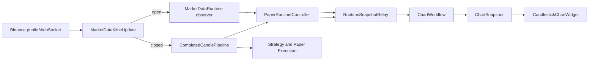

# DEV-146 Real-Time Chart Candles Design

## เป้าหมาย

แสดง OHLC ของแท่ง Candlestick ที่กำลังก่อตัวจาก Binance public WebSocket บน Chart
แบบ real-time หลังผู้ใช้กด `Start Bot` โดยใช้ WebSocket ของ Paper Runtime เดิม
และไม่เปลี่ยน completed-candle trading contract ของระบบ

งานนี้ supersede ข้อ non-goal “No intrabar candle updates” ใน
`2026-08-02-dark-candlestick-chart-design.md` เฉพาะ Chart presentation เท่านั้น
`PRODUCT.md` ยังคงเป็น source of truth ที่ Strategy, indicator, Paper execution,
persistence และ lifecycle decision รับเฉพาะ completed candle

## ขอบเขต

งานนี้ครอบคลุม:

- รับ open และ closed kline updates จาก WebSocket connection เดียวของ Runtime
- ส่ง open kline ไปยัง Chart presentation เท่านั้น
- แทนที่ in-progress candle ล่าสุดตาม `open_time` โดยไม่สร้าง duplicate
- เปลี่ยน in-progress candle เป็น completed candle เมื่อ exchange ส่ง closed update
- แสดง live candle เฉพาะเมื่อ Chart follow ช่วงเวลาล่าสุด
- คงช่วงย้อนหลังเมื่อผู้ใช้กด `Previous`; กลับมารับ live candle เมื่อ `Next` ถึงช่วงล่าสุด
- ล้าง in-progress candle เมื่อ Runtime ไม่อยู่ใน `RUNNING`, เมื่อเปลี่ยน Session,
  หรือเมื่อ Chart เข้า loading/unavailable state
- วาด in-progress candle ด้วยสีและรูปแบบเดียวกับ completed candle โดยไม่มี `LIVE`
  label, badge, opacity หรือ interaction ใหม่
- deterministic unit/integration/acceptance coverage ที่พิสูจน์ routing และ safety

งานนี้ไม่ครอบคลุม:

- การเปลี่ยน Strategy, indicator, Paper Spot/Futures execution, risk policy,
  persistence, replay หรือ durable audit data
- การเปิด WebSocket แยกสำหรับ Chart, REST polling, private Binance API,
  credentials หรือ Live order
- การเพิ่ม volume, indicator, order entry, price alert, chart drawing tool หรือ
  chart interaction อื่น
- การบันทึก in-progress candle ลง SQLite หรือใช้สร้าง TradeFill marker

## Safety Contract

แยกข้อมูลจาก WebSocket เป็นสอง lane ที่มี ownership ชัดเจน:

| Kline state | Consumer ที่อนุญาต | Consumer ที่ห้ามรับ |
| --- | --- | --- |
| Open / in-progress | Chart read-model และ QPainter presentation | completed-candle pipeline, Strategy, execution, persistence, replay |
| Closed / completed | completed-candle pipeline, Strategy, Paper execution, persistence และ Chart | ไม่มี lane พิเศษเพิ่ม |

open update ต้องไม่เปลี่ยน `last_accepted_open_time`, data freshness watermark,
gap/backfill calculation หรือ runtime state และ observer ของ Chart ต้องไม่ทำให้
Market Data Runtime fail closed หาก UI/relay มีข้อผิดพลาด

Paper และ Live safety boundaries ไม่เปลี่ยน งานนี้ใช้ Binance public market data
เหมือน Runtime เดิมและไม่มี order action ใหม่

## แนวทางที่เลือก

เพิ่ม immutable `MarketDataKlineUpdate` ที่เก็บ validated OHLC `Candle` และ
`is_closed` จาก WebSocket source แทนการให้ adapter ทิ้ง open update ทันที
`MarketDataRuntime` เป็น owner ของการ route update: closed update เท่านั้นที่เข้าสู่
`CompletedCandlePipeline`; open update ถูกส่งออกทาง optional presentation observer
ที่ failure-isolated

ไม่เลือก WebSocket แยกสำหรับ Chart เพราะผู้ใช้เลือกให้เริ่มหลัง `Start Bot` และ
connection เดียวทำให้ lifecycle, reconnect, symbol/timeframe binding และ shutdown
คงเป็นของ Runtime เดิม ไม่เลือก REST polling เพราะไม่ให้ latency ตาม WebSocket และ
เพิ่ม request load โดยไม่จำเป็น

## Component Design

### Market Data Source และ Parser

`market_data/candle_source.py` เพิ่ม source contract สำหรับ stream ของ
`MarketDataKlineUpdate` โดย Historical REST contract ยังคืน completed `Candle`
เหมือนเดิม `BinancePublicMarketData` เปิด WebSocket เพียงหนึ่ง connection และ parse
ทุก valid message เป็น update พร้อม `is_closed` จาก `k.x`

`parse_websocket_kline()` เปลี่ยนจากการคืน `Candle | None` เป็น validated update
สำหรับทั้ง open และ closed kline โดยยังตรวจ symbol, timeframe, UTC open time และ
OHLC เหมือนเดิม ไม่มี volume ใน model ใหม่นี้

Fakes ทุกตัวที่ implement live source ต้องคืน update type เดียวกัน เพื่อให้ test
พิสูจน์ route ได้โดยไม่พึ่ง network

### MarketDataRuntime และ PaperRuntimeController

`MarketDataRuntime` consume update stream เดียว:

1. ถ้า `is_closed` เป็น `True` ส่ง `Candle` เข้า `CompletedCandlePipeline` ตาม flow
   เดิมทั้งหมด รวม validation, deduplication, gap/backfill, delivery watermark และ
   freshness
2. ถ้า `is_closed` เป็น `False` เรียก optional observer แบบ best-effort แล้วรอ update
   ถัดไป โดยไม่แตะ pipeline หรือ runtime status

`PaperRuntimeController` รับ open update จาก Runtime และส่งต่อผ่าน
`RuntimeSnapshotRelay` เป็น generation-bound presentation event คล้าย completed
candle event ที่มีอยู่แล้ว callback นี้ถูก catch เพื่อให้ Chart observer failure ไม่
ทำให้ Paper Runtime หรือ trading state เปลี่ยน

### Chart Read Model และ Workflow

`ChartSnapshot.candles` ยังคงเป็น completed candles เท่านั้น เพิ่ม optional
`in_progress_candle` เป็น fact แยกต่างหาก พร้อม validation ว่า:

- symbol/timeframe ตรงกับ Session
- `open_time` ตรงกับขอบหลังของ current completed `ChartRange`
- OHLC valid และ update ถูก observe ภายใน interval นั้น
- loading, unavailable และ historical snapshot ไม่มี in-progress candle

Chart read model เปิด property สำหรับ painter ที่รวม completed candles กับ optional
in-progress candle โดยไม่เปลี่ยน semantic ของ `candles` หรือ `ChartRange`

`ChartWorkflow` เป็น owner ของ follow-latest state:

- เริ่ม Session ด้วย `following_latest=True`
- `Previous` เปลี่ยนเป็น `False`; workflow buffer open update ล่าสุดไว้ได้ แต่ไม่ emit
  snapshot หรือเปลี่ยน visible range
- `Next` ที่มาถึง latest completed range เปลี่ยนกลับเป็น `True` และ apply buffer
  ที่ตรงกับ range ปัจจุบัน
- completed candle ขณะ follow-latest ใช้ refresh flow เดิมเพื่อเลื่อน completed range,
  clear in-progress candle เดิม และรับ open update ของ interval ใหม่
- completed candle ขณะดู historical range ไม่เลื่อนหรือ reload view
- lifecycle snapshot ที่ไม่ใช่ `RUNNING`, session configure, loading, unavailable,
  retry และ close ล้าง in-progress candle/buffer

การเก็บ `following_latest` แยกจากการเทียบ clock ณ ขณะนั้น ป้องกัน view ล่าสุด
สูญเสียสถานะเมื่อ clock ข้าม boundary ก่อน closed kline มาถึง

### Rendering และ Interaction

`CandlestickChartWidget` ใช้ display-candle property สำหรับ price scale, candle width
และ drawing โดย in-progress candle ใช้ green/red rule เดียวกับ completed candle ไม่มี
ข้อความหรือ affordance ใหม่

เมื่อ in-progress candle มีอยู่ painter ขยายเฉพาะ visual x-range ออกหนึ่ง timeframe
เพื่อให้แท่งล่าสุดอยู่ภายใน surface โดย header range และ Previous/Next semantics ยังคง
อ้าง completed `ChartRange` เดิม Markers ยังคง derive จาก durable `TradeFill` และใช้
completed range เท่านั้น

## Data Flow



เส้น open ไม่มี edge ไป `CompletedCandlePipeline`; เส้น closed ไม่มี behavior ใหม่
นอกจาก completed Chart refresh ที่มีอยู่

## Failure Handling

- malformed/symbol/timeframe-mismatched kline ยังเป็น source failure ตาม public
  market-data policy เดิม; ไม่สร้าง chart fact เทียม
- open update ที่ stale generation, session mismatch, historical range หรือ interval
  ไม่ตรงถูก discard เงียบ ๆ ใน presentation lane
- exception จาก relay/chart observer ถูก isolate และไม่เปลี่ยน Runtime state,
  Strategy, execution หรือ persistence
- Chart load/refresh failure ล้าง open fact และแสดง `Chart unavailable` เฉพาะ surface
  เดิม; Bot Control และ tables ยังคงใช้งานได้
- reconnect/backfill ใช้ completed-candle semantics เดิม และไม่พยายาม restore open
  candle จากก่อน disconnect

## Testing Strategy

ใช้ TDD แยกตาม boundary:

1. parser/source tests: open และ closed kline map เป็น `MarketDataKlineUpdate`,
   one WebSocket stream, validation/error classification เดิมคงอยู่
2. runtime tests: open update เรียก presentation observer แต่ไม่เรียก sink,
   pipeline/watermark/runtime-state ไม่เปลี่ยน; closed update ส่ง sink ตามเดิม;
   observer exception ไม่ทำให้ runtime fail closed
3. Paper Runtime/relay tests: open update ส่ง generation-bound event ไป UI ได้,
   stale generation และ observer exception ถูก discard
4. chart data/workflow tests: validation ของ in-progress fact, replacement by open
   time, closed transition, follow-latest, historical gating, Next-to-latest และ
   Stop/Blocked/session cleanup
5. widget tests: in-progress candle ใช้ normal green/red glyph, price scale ครอบคลุม
   candle ล่าสุด, ไม่มี label/action ใหม่ และ range controls ยัง keyboard-accessible
6. desktop acceptance: fake Paper Spot และ Futures runtime แสดง open candle หลัง
   Start, ไม่มี trade/state/persistence side effect จน closed candle มาถึง

ทุก test ใช้ fake transport, fake scheduler และ temporary SQLite เท่านั้น ไม่มี network
หรือเงินจริง

## Verification

ก่อนปิด `DEV-146` ต้องรัน:

```bash
QT_QPA_PLATFORM=offscreen PYTHONPATH=src .venv/bin/python -m pytest -q
.venv/bin/python -m ruff check src tests
.venv/bin/python -m ruff format --check src tests
PYTHONPATH=src .venv/bin/python -m mypy
git diff --check
```

รวม focused parser/runtime/chart/widget/desktop acceptance tests ในแต่ละ TDD cycle
และตรวจ diff ว่าไม่มี Live/private API, credentials, order entry หรือ persistence ของ
in-progress candle

## เงื่อนไขความสำเร็จ

หลัง Start Bot Chart current range แสดงแท่งที่กำลังก่อตัวจาก WebSocket connection
เดียวและแทนที่ตามราคาใหม่ได้, History navigation ไม่ถูกดึงกลับ, Stop/Blocked/session
transition ล้างแท่งชั่วคราว, completed candle path มีผลเหมือนเดิม และไม่มี open update
เข้าถึง Strategy, execution, persistence หรือ replay ได้
