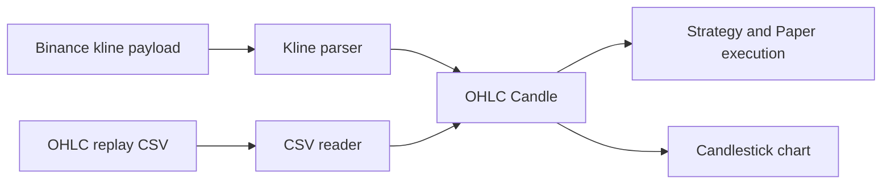

# Remove Candle Volume Design

## เป้าหมาย

ถอดข้อมูล `volume` ที่ไม่มีผู้ใช้งานจริงออกจากโมเดลตลาด เส้นทาง replay และ
Candlestick chart เพื่อให้ระบบใช้ completed candle แบบ OHLC เท่านั้น โดยไม่เปลี่ยน
Strategy, execution, lifecycle หรือ Trading Safety

## ขอบเขต

- ลบ `volume` ออกจาก `Candle` และ validation ของ field นี้
- เปลี่ยน deterministic replay CSV เป็น header
  `open_time,open,high,low,close`
- ให้ Binance kline parser แปลงเฉพาะเวลาและ OHLC แม้ payload ต้นทางยังมี volume
  ตาม protocol ของ Binance
- ลบ Volume panel, volume bars, divider และพื้นที่สงวนสำหรับ Volume ออกจาก
  `CandlestickChartWidget`
- ขยายพื้นที่วาดราคาให้ใช้ chart surface ที่เหลือทั้งหมด
- ปรับ tests, fixtures และเอกสาร Source of Truth ที่อธิบาย Candle หรือ replay เป็น
  OHLCV ให้เป็น OHLC

## สิ่งที่ไม่ทำ

- ไม่เปลี่ยนเงื่อนไข RSI Step Grid, ATR, Entry, Basket Take Profit หรือ PnL
- ไม่เปลี่ยน completed-candle semantics หรือ timeframe validation
- ไม่เพิ่ม compatibility layer สำหรับ replay CSV รูปแบบเดิม
- ไม่เปลี่ยน Binance public API contract หรือจำนวน field ที่ exchange ส่งมา
- ไม่เพิ่ม schema migration เพราะ `Candle` และ replay candle ไม่ได้ persist volume
  ใน SQLite

## แนวทางที่เลือก

ใช้ breaking change แบบตรงไปตรงมา: `Candle` เป็น OHLC และ replay CSV ไม่มีคอลัมน์
`volume` ไฟล์ replay รูปแบบเดิมจะถูกปฏิเสธด้วย header validation จนกว่าจะลบคอลัมน์
ดังกล่าวออก

แนวทางนี้ลบ field ที่ไม่มี consumer จริงออกจาก domain โดยไม่เก็บ optional field หรือ
compatibility branch ที่จะเพิ่ม state และ test cases โดยไม่สร้างคุณค่าให้ Internal Alpha

แนวทางอื่นที่พิจารณา:

1. เก็บ `volume` เป็น optional ชั่วคราวเพื่อรองรับ CSV สองรูปแบบ แต่ยังทำให้ domain
   มีข้อมูลที่ไม่ได้ใช้และไม่ตรงกับเป้าหมาย
2. ลบเฉพาะ UI และ CSV แต่คง `Candle.volume` ไว้ ซึ่งลดเพียง presentation แต่ไม่ลด
   domain surface

## การออกแบบ

### Market Data Model

`market_data/candle.py` ยังคงเป็นเจ้าของ immutable completed-candle fact แต่เหลือ
เฉพาะ `symbol`, `timeframe`, `open_time`, `open`, `high`, `low` และ `close`
Price validation, finite decimal validation, range validation และ timeframe alignment
ยังทำงานเหมือนเดิม

### Binance Boundary

Binance kline payload ยังคงมี positional volume field ตาม exchange protocol
`integrations/binance/kline_parser.py` ต้องตรวจ shape ที่จำเป็นต่อการอ่าน OHLC และ
timestamp แต่ไม่สร้าง `Decimal` สำหรับ volume และไม่ส่งค่าดังกล่าวเข้า `Candle`

การเปลี่ยนนี้ไม่เพิ่ม private endpoint, credentials หรือ network behavior ใหม่

### Deterministic Replay

`replay/csv_candles.py` ยอมรับ header ตามลำดับที่แน่นอนเท่านั้น:

```text
open_time,open,high,low,close
```

ทุก OHLC field ต้องแปลงเป็น finite `Decimal` โดยไม่ผ่าน `float` เหมือนเดิม
CSV ที่ยังมี `volume`, ขาด field, สลับลำดับ หรือมี field เกินจะ fail fast ด้วย
sanitized row/header error ไฟล์ fixture หลักจะเปลี่ยนเป็นรูปแบบใหม่โดยผลลัพธ์ Paper
Spot replay ที่อาศัยราคาเดิมต้องไม่เปลี่ยน

### Chart Rendering

`ui/candlestick_chart.py` จะลบ `CandleGlyph.volume_bar` และ
`ChartPainterModel.volume_divider` รวมทั้ง calculation ของ `max_volume`,
`volume_surface` และ volume height

Price surface จะครอบคลุม chart surface ทั้งหมด Grid, candlestick body/wick และ
Buy/Sell markers จะ scale ตาม price surface ใหม่ Header, range controls,
loading/empty/unavailable states และ marker semantics ไม่เปลี่ยน

### Data Flow



ข้อมูล volume สิ้นสุดที่ transport boundary ของ Binance และไม่เข้าสู่ `Candle`,
Strategy, replay result หรือ UI

## Error Handling และ Compatibility

- Replay CSV รูปแบบเดิมไม่รองรับโดยตั้งใจ และต้องได้รับ error ที่ระบุ header ใหม่
- Binance parser ต้องยังปฏิเสธ payload ที่สั้นเกินกว่าจะอ่าน timestamp และ OHLC
- การไม่แปลง volume ทำให้ volume ที่ malformed ไม่มีผลต่อ Candle เพราะไม่ใช่ข้อมูลที่
  application ใช้อีกต่อไป
- ไม่มี fallback, default volume หรือ sentinel value

## Testing

ใช้ Test-Driven Development โดยเริ่มจาก failing tests ที่ยืนยัน behavior ใหม่:

- `Candle` สร้างได้โดยไม่มี `volume` และไม่มี volume validation
- Binance kline parser คืน OHLC Candle และไม่ expose volume
- replay CSV ยอมรับ header ห้าคอลัมน์และปฏิเสธ header เดิม
- deterministic Paper Spot replay จาก fixture ที่แก้แล้วให้ผลลัพธ์เดิม
- painter model ไม่มี volume geometry/divider และ price glyph ใช้ chart surface ใหม่
- tests และ helpers ทุกจุดสร้าง `Candle` โดยไม่มี `volume`

หลัง implementation ต้องรัน unit tests, integration tests, acceptance tests,
`ruff check`, `ruff format --check`, `mypy` และ `git diff --check` ตาม repository
instructions

## ความเสี่ยง

- Replay CSV ภายนอกที่ยังมีหกคอลัมน์จะใช้งานไม่ได้จนกว่าจะลบ `volume`
- การแก้ constructor ของ `Candle` กระทบ test fixtures และ consumers จำนวนมาก จึงต้อง
  ใช้ type checking และ full test suite เพื่อจับ call site ที่ตกหล่น
- การขยาย price surface เปลี่ยน geometry ของกราฟโดยตั้งใจ แต่ต้องรักษาการมองเห็น
  candlestick และ Buy/Sell markers ทุกขนาดหน้าต่างที่รองรับ

## Acceptance Criteria

1. ไม่มี field หรือ attribute `Candle.volume`
2. replay CSV และ fixture หลักไม่มีคอลัมน์ `volume`
3. Candlestick chart ไม่มี Volume panel, volume bars, divider หรือพื้นที่ว่างสำหรับ
   Volume
4. Binance public market data ยังสร้าง completed OHLC Candle ได้
5. deterministic Paper Spot replay ให้ผลลัพธ์เดิมจากข้อมูลราคาเดิม
6. Strategy, execution, persistence และ Trading Safety behavior ไม่เปลี่ยน
7. เอกสารที่เกี่ยวข้องไม่อธิบาย application Candle หรือ replay format เป็น OHLCV
