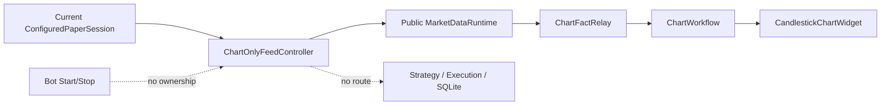

# Chart-only Real-time Feed Design

**Issue:** DEV-150
**Status:** Approved

## Goal

เมื่อ Desktop มี `ConfiguredPaperSession` ปัจจุบัน Chart ต้องโหลดประวัติและ
แสดง forming candle ที่อัปเดตจาก public market data ทันที โดยไม่ต้องกด Start Bot.
การทำงานนี้เป็น read-only chart presentation เท่านั้น และต้องไม่เริ่ม Strategy,
Paper execution, lifecycle persistence หรือส่ง order.

## Scope and non-goals

ในขอบเขต:

- เปิด Chart-only feed หลัง Session ถูก restore ตอน startup หรือถูกสร้างใหม่
- รับ completed และ in-progress candle ผ่าน public market-data transport
- ให้ chart ติดตามช่วงล่าสุดและแสดง forming candle ต่อเนื่องเมื่อ bot เป็น
  `CONFIGURED`, `RUNNING` หรือ `STOPPED`
- ปิด feed เมื่อเปลี่ยน Session หรือ Desktop shutdown และทิ้ง callback เก่า
- แสดง Chart unavailable/retry เมื่อ feed ล้มเหลว โดยไม่เปลี่ยน Bot state

นอกขอบเขต:

- Strategy, indicators, Entry Intent, execution, Basket, Fill และ persistence
- การเปลี่ยน Bot lifecycle semantics หรือ database schema
- Live credentials, private endpoints และ Live order
- การเก็บ forming candle ลง durable storage

## Design

### Chart feed ownership

เพิ่ม application-owned `ChartOnlyFeedController` ที่รับ
`ConfiguredPaperSession`, public candle source factory และ relay สำหรับ immutable
chart facts. Controller สร้าง `MarketDataRuntime` แบบ read-only โดยใช้ sink ที่
ส่ง completed/in-progress candle ไปยัง relay เท่านั้น. Controller ไม่มี dependency
ไปยัง `trading`, `execution`, SQLite lifecycle หรือ `PaperRuntimeController`.

controller จะ warm up และ subscribe public transport ใน worker เดิมของ desktop
composition. completed candle และ forming candle ถูกส่งผ่าน generation-bound relay
กลับเข้ Qt thread; UI จึงรับเฉพาะ immutable fact และไม่มี transport dependency.

### Lifecycle and data flow

`MainWindow` starts the chart feed when it configures a current Session, before or
independently from any Bot lifecycle action. It first asks `ChartWorkflow` to load
the default historical range, then starts the feed. The relay can deliver a forming
candle as soon as the historical snapshot is ready; `ChartWorkflow` preserves the
existing pending-fact handling while loading.

The feed is neither started nor stopped by Bot Start/Stop. Existing bot runtime
callbacks must no longer be the only source of chart updates. To avoid duplicate
updates while a bot is running, the chart feed is the sole UI chart-fact producer;
the bot runtime retains its internal market-data flow for trading but its chart
callbacks are not connected to `ChartWorkflow`.

### Generation safety and shutdown

The controller owns one active feed generation. Starting a feed invalidates the
previous relay generation and stops its runtime before publishing facts for the new
Session. Relay delivery verifies its generation on the Qt thread, so callbacks from
a replaced Session cannot alter the current chart.

Desktop shutdown first invalidates the relay, stops the chart-only runtime within
the existing controlled shutdown boundary, then closes `ChartWorkflow`. New Session
uses the same replace sequence. The controller exposes no restart/resume behavior
beyond an explicit current-Session start.

### Failure behavior

Historical load and feed errors are scoped to `ChartWorkflow`'s existing
unavailable/retry presentation. A feed failure does not call Bot lifecycle actions,
does not alter `BotControlSnapshot`, and does not produce an execution or
persistence side effect. Retry starts/replaces only the chart feed for the current
Session after the chart history retry request succeeds.

### Contracts

- `ChartFactRelay` exposes generation-scoped `completed_candle` and
  `in_progress_candle` notifications; it has no Bot snapshot signal.
- Facts must match current Session symbol/timeframe and remain immutable
  `ChartCandle` values.
- `ChartWorkflow` removes its `runtime_running` gate for valid current-session
  chart facts, while retaining the following-latest-range and observed-interval
  checks.
- `CandlestickChartWidget` remains a presentation-only consumer of
  `ChartSnapshot`.

## Testing

Tests use fake public candle source/runtime only:

1. Desktop with restored Session starts chart history load and chart-only feed
   without `start_bot`.
2. In-progress and completed candles update the latest chart while Bot is
   `CONFIGURED` and after it becomes `STOPPED`.
3. Bot Start/Stop does not start, stop or replace the chart-only feed.
4. Session replacement and shutdown stop the old feed and reject old-generation
   facts.
5. A chart feed failure leaves Bot snapshot/state unchanged and exposes only chart
   unavailable/retry behavior.
6. Static dependency tests prove the chart-only controller has no route to
   strategy, execution, lifecycle persistence, SQLite or private endpoints.

Quality gates: focused unit/UI/desktop tests, full `pytest`, Ruff check/format,
Mypy and `git diff --check`.

## Risks and mitigations

- Two public subscriptions during a running Bot would duplicate network use.
  The chart-only feed is deliberately the sole source for UI chart facts, while
  the Bot keeps its separate trading runtime source; this is accepted for this
  slice because sharing a runtime would re-couple chart availability to Bot
  lifecycle. The implementation must document and test the separation.
- A late callback can show the prior Session. Relay generation invalidation and
  Session symbol/timeframe validation prevent this.
- Chart transport failure could look like Bot failure. Failure handling is scoped
  to chart read state and has no lifecycle transition path.
